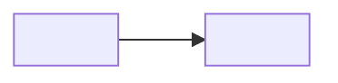

## Goal

Produce diagrams that match the code. Every box and arrow must come from a file that was read. No generic "frontend → backend → database" placeholders.

## Workflow

1. **Scope first.** Ask which diagram is wanted if it is not obvious: context (system + actors), container (services/apps/stores), data flow, or one request sequence. Default to container for a repo overview.
2. **Collect evidence.** Read manifests, entry points, route definitions, config files, DB schemas, and queue producers/consumers. Note the exact file that proves each component and each edge.
3. **Name real components.** Use the names found in code — package names, binary names, route prefixes, table names. Avoid abstract labels.
4. **Draw one diagram per question.** Keep each diagram under ~15 nodes. If it gets bigger, split by boundary (e.g. one per service) and add an index diagram.
5. **Use Mermaid.** Prefer `flowchart LR` for structure, `sequenceDiagram` for request flow, `erDiagram` for schema. Put a short caption under each diagram stating what it proves.
6. **Verify edges.** For each arrow, confirm the caller and callee exist and the direction is right (who calls whom, who writes to which store). Delete any arrow you cannot prove.
7. **Write to `docs/architecture.md`** (or ask where). Include an evidence table: component → file, edge → file. Append to existing docs instead of overwriting.
8. **Validate syntax.** Mermaid must parse. If a parser is available, run it; otherwise manually check node IDs, arrow syntax, and quoting of labels with special characters.

## Rules

- No invented components, no guessed infrastructure, no claims about deployments that are not in the repo.
- Quote labels containing `(`, `)`, `:`, or `/` — Mermaid breaks on them otherwise.
- Do not put secrets, tokens, or internal hostnames in diagrams.
- State "not verified in this environment" for anything inferred rather than read.
- Keep prose minimal: the diagram is the deliverable, the evidence table is the proof.

## Output shape

```
# <repo> architecture

## Container view



<one-line caption: what this proves>

## Evidence

| Component / edge | Source |
| --- | --- |
| <name> | `path/to/file` |

## Not verified
- <list, or "none">
```
